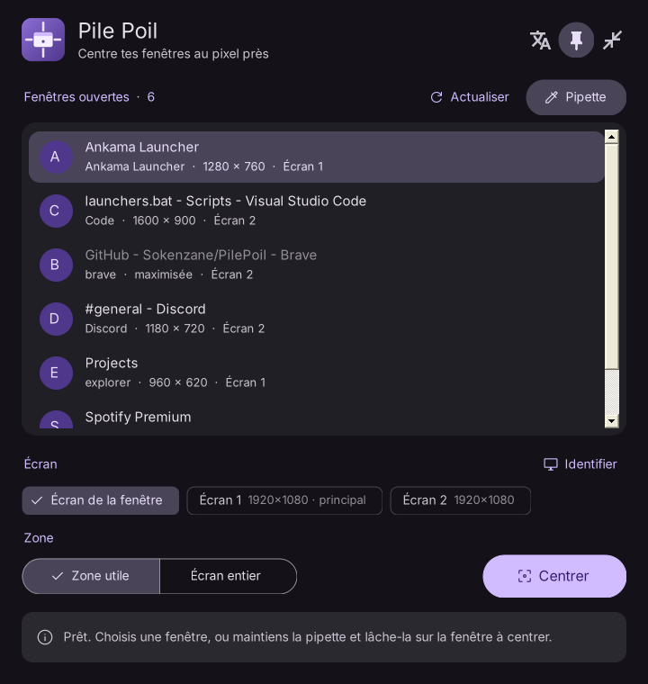
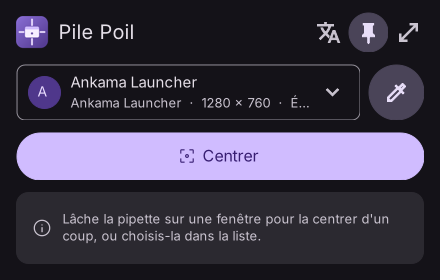

  

<h1 align="center">Pile Poil</h1>

  Centre n'importe quelle fenêtre <b>au pixel près</b>, sur l'écran de ton choix. 
  Un petit <code>.exe</code>, rien à installer. Windows 10 et 11.

  
  
  

  <a href="https://github.com/Sokenzane/PilePoil/releases/latest/download/PilePoil.exe"><b>Télécharger PilePoil.exe</b></a>
  &nbsp;·&nbsp; <a href="README.md">Read in English</a>

  

## Sommaire

- [Pourquoi Pile Poil ?](#pourquoi-pile-poil-)
- [Téléchargement](#téléchargement)
- [Utilisation](#utilisation)
- [Mode compact](#mode-compact)
- [Raccourcis clavier](#raccourcis-clavier)
- [Cas particuliers](#cas-particuliers)
- [Langue](#langue)
- [Réglages](#réglages)
- [Compiler soi-même](#compiler-soi-même)
- [Contribuer](#contribuer)
- [Licence](#licence)

## Pourquoi Pile Poil ?

Windows sait maximiser ou ancrer une fenêtre, mais pas simplement la placer **pile au milieu** de l'écran en gardant sa taille. Et la plupart des outils de centrage sont décalés de quelques pixels. Pile Poil est exact :

- **Bordures invisibles ignorées** : sous Windows 10/11, chaque fenêtre a des bordures invisibles d'environ 7 px. Pile Poil centre la partie que tu *vois*.
- **Mises à l'échelle différentes gérées** : tous les calculs se font en pixels physiques, le centrage reste juste avec des écrans à 100 % et 125 %.
- **Changement d'écran géré** : si une application se redimensionne en arrivant sur un écran avec une autre mise à l'échelle, Pile Poil la recentre avec sa nouvelle taille.
- **Vérifié, pas supposé** : après le déplacement, Pile Poil mesure à nouveau la fenêtre et affiche les vraies marges (par exemple `← 480 | 480 →`).

La taille de la fenêtre n'est jamais modifiée, seulement sa position.

## Téléchargement

**[Télécharge PilePoil.exe](https://github.com/Sokenzane/PilePoil/releases/latest/download/PilePoil.exe)** (environ 120 Ko) et lance-le. Pas d'installation, pas de droits administrateur. Les notes de version et les versions précédentes sont sur la page [Releases](https://github.com/Sokenzane/PilePoil/releases), avec l'empreinte SHA-256 de chaque exe (voir [SECURITY.md](SECURITY.md#verifying-a-download)). Il a besoin de .NET Framework 4, présent sur tous les Windows 10 et 11.

> L'exe n'est pas signé numériquement : Windows SmartScreen peut afficher « Windows a protégé votre ordinateur ». Clique sur **Informations complémentaires**, puis **Exécuter quand même**. Tu peux aussi [le compiler toi-même](#compiler-soi-même) en un clic.

## Utilisation

1. **Choisis une fenêtre** :
   - dans la liste des fenêtres ouvertes,
   - ou avec la **pipette** : maintiens le clic dessus, glisse jusqu'à la fenêtre voulue (un cadre violet l'entoure), relâche.
2. **Choisis l'écran** : celui de la fenêtre, ou un autre. **Identifier** affiche le numéro de chaque écran en grand.
3. **Choisis la zone** : *Zone utile* (sans la barre des tâches) ou *Écran entier*.
4. Clique sur **Centrer**, ou double-clique sur la fenêtre dans la liste.

Les boutons en haut à droite changent la [langue](#langue), gardent Pile Poil au premier plan et passent en [mode compact](#mode-compact).

## Mode compact

  

Une petite fenêtre avec l'essentiel : un menu déroulant pour choisir la fenêtre, la pipette et **Centrer**. **Lâcher la pipette sur une fenêtre la centre aussitôt**, en un seul geste. Le mode compact utilise l'écran actuel de la fenêtre et la zone choisie en mode complet.

Pile Poil se souvient du mode utilisé et se rouvre de la même façon.

## Raccourcis clavier

| Touche | Action |
|---|---|
| `Entrée` | Centrer la fenêtre choisie |
| `F5` | Actualiser les fenêtres et les écrans |
| `Échap` | Quitter |

## Cas particuliers

| Situation | Comportement |
|---|---|
| Fenêtre maximisée | Refusée : la restaurer d'abord |
| Fenêtre réduite | Restaurée, puis centrée |
| Fenêtre plus haute que l'écran | Centrée horizontalement, collée en haut pour garder sa barre de titre accessible |
| Application lancée en administrateur | Windows interdit de la déplacer : lancer aussi Pile Poil en administrateur |
| Taille impaire | 1 px d'écart inévitable, signalé dans le bandeau |

## Langue

Clique sur le bouton de langue (icône de traduction) en haut à droite pour passer du français à l'anglais ; ton choix est mémorisé. Tant que tu n'as rien choisi, Pile Poil suit la langue d'affichage de Windows : **français** si Windows est en français, **anglais** sinon. Tu peux aussi la forcer au lancement : `PilePoil.exe --lang=fr` ou `--lang=en`.

Tu veux ajouter ta langue ? C'est un seul bloc de texte à traduire, voir [CONTRIBUTING.md](CONTRIBUTING.md#add-a-language).

## Réglages

Tes choix (langue, mode compact, premier plan, zone) sont enregistrés dans `%APPDATA%\PilePoil\settings.ini`. Supprime ce fichier pour tout remettre à zéro ; rien d'autre n'est écrit dans le système.

## Compiler soi-même

Tout est dans un seul fichier, [`src/PilePoil.cs`](src/PilePoil.cs) (C# 5, WinForms, aucune dépendance).

1. Clone ou télécharge le dépôt.
2. Double-clique sur **`build.bat`** : il utilise le compilateur C# fourni avec Windows.
3. Lance `dist\PilePoil.exe`.

`PilePoil.exe --demo` affiche de fausses fenêtres et de faux écrans, pratique pour les captures d'écran (ajoute `--compact` pour le mode compact).

## Contribuer

Les signalements de bugs, idées et pull requests sont les bienvenus. Voir [CONTRIBUTING.md](CONTRIBUTING.md) (en anglais).

## Licence

Pile Poil est un logiciel libre, publié sous la [licence publique générale GNU v3.0](LICENSE).
Tu peux l'utiliser, l'étudier, le partager et le modifier ; les versions modifiées que tu distribues doivent rester open source sous la même licence et créditer le projet d'origine.

Copyright © 2026 [Sokenzane](https://github.com/Sokenzane).

Icônes : [Material Symbols](https://fonts.google.com/icons) de Google, licence Apache 2.0. Voir [THIRD_PARTY_NOTICES.md](THIRD_PARTY_NOTICES.md).
