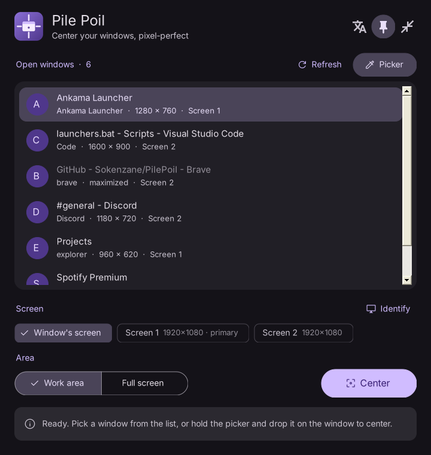
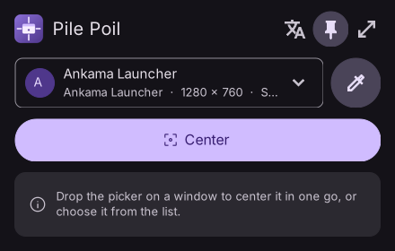

  

<h1 align="center">Pile Poil</h1>

  Center any window, <b>pixel-perfect</b>, on the screen of your choice. 
  One small <code>.exe</code>, nothing to install. Windows 10 and 11.

  
  
  

  <a href="https://github.com/Sokenzane/PilePoil/releases/latest/download/PilePoil.exe"><b>Download PilePoil.exe</b></a>
  &nbsp;·&nbsp; <a href="README.fr.md">Lire en français</a>

  

## Contents

- [Why Pile Poil?](#why-pile-poil)
- [Download](#download)
- [How to use](#how-to-use)
- [Compact mode](#compact-mode)
- [Keyboard shortcuts](#keyboard-shortcuts)
- [Special cases](#special-cases)
- [Language](#language)
- [Settings](#settings)
- [Build from source](#build-from-source)
- [Contributing](#contributing)
- [License](#license)

## Why Pile Poil?

*"Pile poil"* is French for *"spot on"*. Windows can maximize or snap a window, but not simply put it **right in the middle** of the screen at its current size. Most centering tools are also a few pixels off. Pile Poil is exact:

- **Invisible borders ignored**: on Windows 10/11, every window has ~7 px invisible resize borders. Pile Poil centers the part you actually *see*.
- **Mixed scaling handled**: all maths happen in physical pixels, so centering stays exact with screens at 100 % and 125 %.
- **Screen change handled**: if an app resizes itself when it lands on a screen with another scaling, Pile Poil centers it again with its new size.
- **Checked, not assumed**: after moving the window, Pile Poil measures it again and shows the real margins (e.g. `← 480 | 480 →`).

The window size is never changed, only its position.

## Download

**[Download PilePoil.exe](https://github.com/Sokenzane/PilePoil/releases/latest/download/PilePoil.exe)** (about 120 KB) and run it. No installer, no admin rights. Release notes and previous versions are on the [Releases](https://github.com/Sokenzane/PilePoil/releases) page, with the SHA-256 of each exe (see [SECURITY.md](SECURITY.md#verifying-a-download)). It needs .NET Framework 4, which comes with every Windows 10 and 11.

> The exe is not code-signed, so Windows SmartScreen may show *"Windows protected your PC"*. Click **More info**, then **Run anyway**. You can also [build it yourself](#build-from-source) in one click.

## How to use

1. **Pick a window**:
   - from the list of open windows,
   - or with the **picker**: hold the mouse button on it, drag over the window you want (it gets a purple frame), release.
2. **Pick a screen**: the window's current screen, or another one. **Identify** shows each screen's number in big.
3. **Pick an area**: *Work area* (without the taskbar) or *Full screen*.
4. Click **Center**, or double-click the window in the list.

The buttons at the top right change the [language](#language), keep Pile Poil on top of other windows, and switch to [compact mode](#compact-mode).

## Compact mode

  

A small window with just what you need: a drop-down to choose the window, the picker and **Center**. **Dropping the picker on a window centers it right away**, in one gesture. It uses the window's current screen and the area chosen in full mode.

Pile Poil remembers the mode you were in and reopens the same way.

## Keyboard shortcuts

| Key | Action |
|---|---|
| `Enter` | Center the selected window |
| `F5` | Refresh windows and screens |
| `Esc` | Quit |

## Special cases

| Situation | What happens |
|---|---|
| Maximized window | Refused: restore it first |
| Minimized window | Restored, then centered |
| Window taller than the screen | Centered horizontally, aligned to the top to keep its title bar reachable |
| App running as administrator | Windows does not allow moving it: run Pile Poil as administrator too |
| Odd size | 1 px offset is unavoidable, the status bar says so |

## Language

Click the language button (translate icon) at the top right to switch between English and French; your choice is remembered. Until you choose, Pile Poil follows your Windows display language: **French** if Windows is in French, **English** otherwise. You can also force it at launch: `PilePoil.exe --lang=en` or `--lang=fr`.

Want to add your language? It is a single block of text to translate, see [CONTRIBUTING.md](CONTRIBUTING.md#add-a-language).

## Settings

Your choices (language, compact mode, always on top, area) are saved in `%APPDATA%\PilePoil\settings.ini`. Delete that file to reset them; nothing else is written to your system.

## Build from source

Everything is in one file, [`src/PilePoil.cs`](src/PilePoil.cs) (C# 5, WinForms, no dependency).

1. Clone or download the repository.
2. Double-click **`build.bat`**: it uses the C# compiler that ships with Windows.
3. Run `dist\PilePoil.exe`.

`PilePoil.exe --demo` shows fake windows and screens, handy for screenshots (add `--compact` for the compact mode).

## Contributing

Bug reports, ideas and pull requests are welcome. See [CONTRIBUTING.md](CONTRIBUTING.md).

## License

Pile Poil is free software, released under the [GNU General Public License v3.0](LICENSE).
You can use, study, share and modify it; modified versions you distribute must stay open source under the same license and credit the original project.

Copyright © 2026 [Sokenzane](https://github.com/Sokenzane).

Icons: [Material Symbols](https://fonts.google.com/icons) by Google, Apache License 2.0. See [THIRD_PARTY_NOTICES.md](THIRD_PARTY_NOTICES.md).
